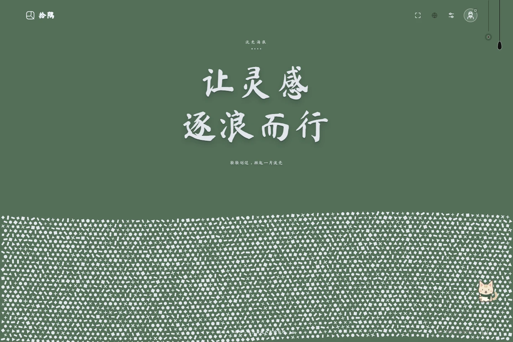
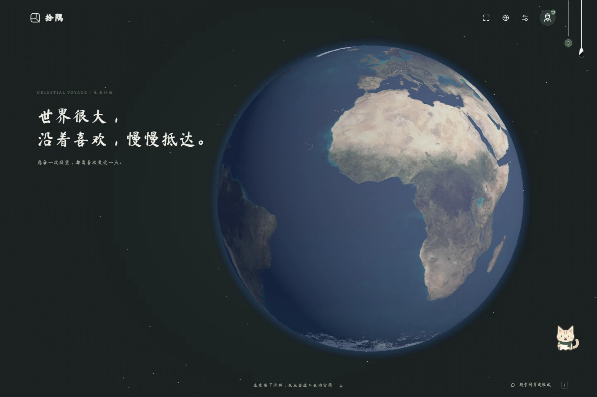

# 主题亮点补充

可放在首篇文章「02 / 一个首页，换成自己喜欢的样子」中，与黑胶时光一起展示。

## 灵感流体｜让灵感，自在流动

轻轻划过，画面中的粒子便像液体一样涌动。工作间隙，随手拨动一片波浪，让思绪也跟着松一松。

*真实主题截图；流动与互动效果需进入网站体验。*

## 星海行旅｜把世界，放在首页

一颗立体地球，铺开海洋与大陆；深色星空，让每天的打开多一点辽阔。还没出发，也可以先让目光去远方走走。

*真实主题截图。*

---

素材说明：两张图片原样取自项目现有产品实景截图 theme-flow.webp、theme-globe.webp，并非 AI 重绘；本次整理为公众号配图，未修改原文章或产品界面。
