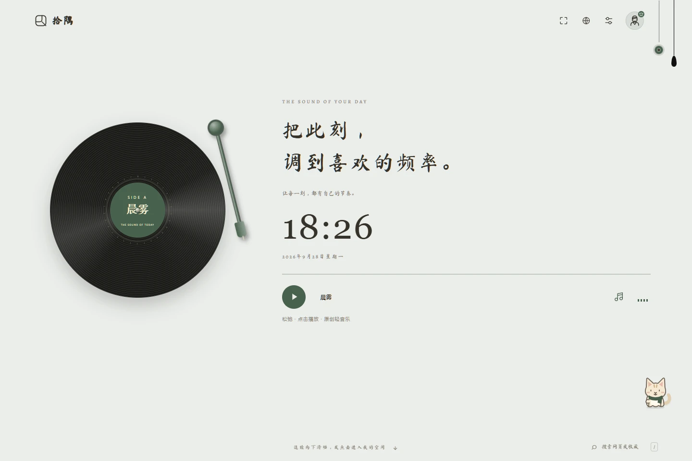
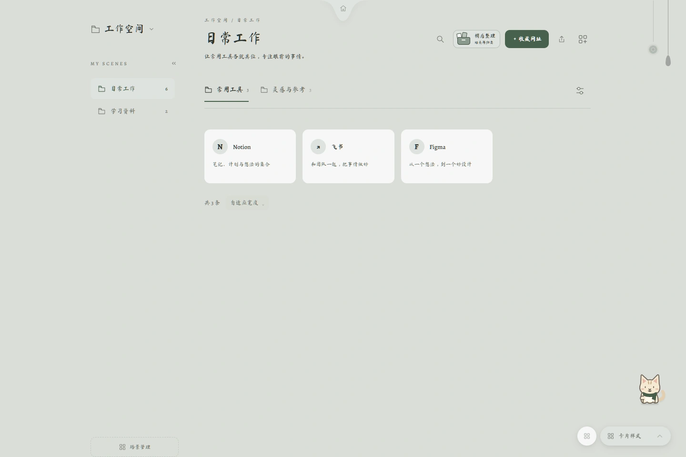
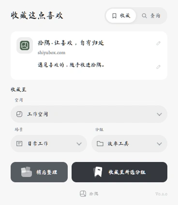

# 拾隅｜世界很大，留一隅给自己

每天打开浏览器，我们都会遇到一些值得留下的东西：一个好用的工具、一篇想再读的文章、一份恰好需要的资料。

可收藏越来越多，真正用到的时候，却常常想不起放在哪里。

我们做拾隅，就是希望这些发现有地方安放，也能在需要时，重新回到你手边。

**拾隅，是一个以网址收藏为起点的个人上网入口。**

在这里，你可以整理收藏、布置首页、记录灵感，把工作、学习与生活中常用的东西，放进属于自己的空间。

**01 / 我们想做的，是一个愿意每天打开的地方**

“拾”，是收下每一次有价值的发现；“隅”，是给自己留一处自在的角落。

我们相信，收藏的意义，在于日后还能找到、用到；一个顺手的上网入口，也应该容得下自己的习惯和审美。

所以，拾隅想把两件事做好：**让有用的内容井井有条，让每天的打开赏心悦目。**

**02 / 一个首页，换成自己喜欢的样子**

喜欢清爽，可以选择「留白日常」；想给日常一点氛围，可以走进「黑胶时光」；对星空充满好奇，也可以打开「星际漫游」。

从主题、配色到字体与布局，你可以按自己的喜好调整。

开始工作前、学习间隙，或只是打开浏览器的那一刻，都有一个熟悉而舒服的起点。

*拾隅主题实景：黑胶时光。*

**03 / 一个空间，让收藏找得到、用得上**

工作工具、学习资料、旅行攻略、创作参考，都可以按「空间—场景—分组」整理。

比如，把办公网站放进「工作」，把课程与教程放进「学习」，再按具体项目或兴趣细分。需要时，通过分类或搜索找回，不必重新翻找一遍。

**让每一个收藏，都有清楚的去处。**

*收藏空间实景，图中网址为示例内容。*

**04 / 一个插件，把喜欢随手收下**

浏览网页时遇到好内容，打开拾隅浏览器插件，就能收藏当前网址，并补充名称与备注。

想好放哪里，就直接归入对应分组；暂时没空整理，就先放进「稍后整理」。

查资料时先收集，忙完后再归类，让收藏顺着你的节奏来。

*在当前网页收藏，或留待稍后整理。*

**05 / 一些小工具，接住日常的小事**

突然想到的点子，用「小记」留下；今天要完成的事情，用「待办」记好。

查资料时顺手记下思路，开始工作前理一理今天的安排。让网址、想法和行动，在同一个入口衔接起来。

**接下来，去发现更大的世界**

我们也在准备「世界」板块，希望把优质网址、创作者、专题合集与学习路线带到你面前，让每一次好奇，都有继续探索的方向。

*「世界」板块尚未开放，后续会单独介绍。*

世界很大，值得留下的东西很多。

愿拾隅成为你的一个小小起点：**从这里出发，把喜欢带回来。**

欢迎体验 **拾隅**：https://shiyubox.com/

也欢迎留言告诉我们：你最想在自己的拾隅里，收下什么？
